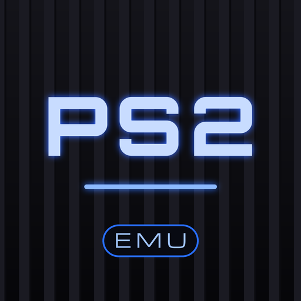

# Lineage PS2 for PS5

Welcome to **Lineage**, my attempt at a faithful interface for emulators. Right now that's this and the [PS1 version](https://github.com/lineage-shell/lineage-ps1-for-ps5), both on PS5. In the future, I'd like to run the same design across PC emulators, from one shared core. There's a lot of research and QA before we get there though!

## The PS2's own menu, back on your PS5

This is a front end for [PS5SX2](https://github.com/Swordpdf/PS5SX2) that looks and behaves like a real PS2. Open it and you get the opening with the towers, the main menu with the clock, the Browser with your memory cards and the disc in the drive, and System Configuration. Your games live in a Library that's styled to match, and every game starts with the "PlayStation 2" logo, like it used to.

None of Sony's stuff is in here. The artwork, fonts and sounds all come from your own BIOS when the app starts.

> Screenshots and a video are on the release page and in the announcement post. They're not in the repo because they show artwork from a Sony BIOS.

## Features

- **Rebuilt from the original console:** the opening with the towers (grown from your own play time), the main menu with the clock, the Browser with your memory cards and their 3D save icons, the disc in the drive, and System Configuration.
- **Added:** a Library of your games as cases (search, sort, favourites, flip a case with R3 to read the back), a page for each game, the "PlayStation 2" logo before every game, and folder memory cards with no 8 MB limit.
- **Play like we used to** with your memory card saves, or pick up a save state if you've got one.
- **One combo for the in-game menu:** hold L3 + R3 to pause, save, load or quit. It's the same in every Lineage release, so no more forgetting how to get back to the emulator.
- **16:9 and 4:3** support.

## What you need

- A jailbroken PS5 with kstuff. Tested on firmware 11.40.
- A way to put homebrew apps on your home screen, e.g. [ShadowMountPlus](https://github.com/drakmor/ShadowMountPlus).
- The PS5SX2 Helper payload, from [PS5SX2's releases](https://github.com/Swordpdf/PS5SX2/releases). It unlocks the emulator when it starts, and handles physical PS2 discs if you want to play from the drive.
- Your own PS2 BIOS, dumped from your own console.

## Install

1. Grab `Lineage-PS2-v1.0-PPSA99204.zip` from [Releases](../../releases) and unzip it.
2. Copy the `PPSA99204` folder to `/data/homebrew/PPSA99204` and register it like any other homebrew app (restart ShadowMountPlus). The tile is called "PlayStation 2".
3. Put your PS2 BIOS in `/data/PCSX2/bios`. If it's somewhere else, the app asks for it on first launch and lets you pick the folder.

It sits alongside PS5SX2 and shares its games, memory cards and settings (everything lives under `/data/PCSX2/`). To update, replace the folder. To remove it, delete the folder; your saves stay put.

**Only tested with SCPH-70004 v2.00 (PAL).** Other BIOS versions should work but I haven't tried them. If you do, let me know how it goes.

## Bugs and feedback

Open an [issue](../../issues) with your BIOS version, the game and what happened.

## Credits

- UI: @kurolume
- PS5 port: PS5SX2 by [@Swordpdf](https://github.com/Swordpdf)
- Emulator: [PCSX2](https://github.com/PCSX2/pcsx2)

This build wouldn't be possible without PS5SX2 or PCSX2, so a big thank you to everyone who's worked on them.

Built with the help of Claude (Anthropic).

## Want to help?

I've only got a couple of hours a week for this, so if you want to support and put some time in, drop me a line (@kurolume). That can be design or development. Whatever floats your boat :)

## Legal

Not affiliated with or endorsed by Sony Interactive Entertainment. No Sony code or assets are included; you need your own BIOS, dumped from your own console. "PlayStation" and "PS2" are Sony's trademarks and are only used to say what this recreates.

GPL-3.0, same as PCSX2 and PS5SX2. See [COPYING.GPLv3](COPYING.GPLv3).
